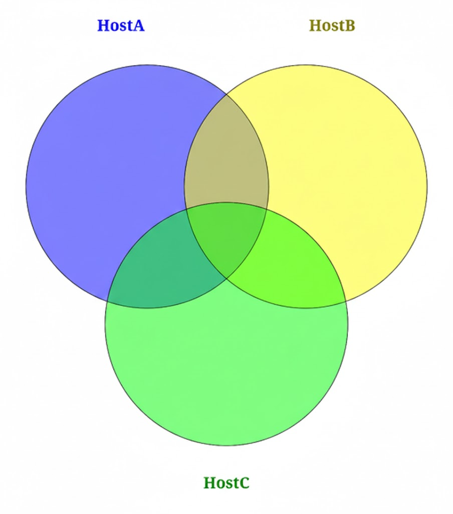

# RFLXN's NixOS Configuration

## Overview

This repository contains RFLXN's multi-host NixOS configuration. A single flake manages three machines, backed by a shared module library that keeps reusable behavior separate from host-specific composition.

| Host | Platform | Role |
| --- | --- | --- |
| `rflxn-desktop` | `x86_64-linux` | Hyprland workstation and gaming desktop |
| `rflxn-asahi` | `aarch64-linux` | Apple Silicon laptop running NixOS with Asahi support |
| `rflxn-server` | `x86_64-linux` | Headless server for storage, sync, remote development, and network services |

[`flake.nix`](./flake.nix) is the entry point. Host definitions live under [`hosts/`](./hosts), and the reusable module library is exported from [`modules/default.nix`](./modules/default.nix).

## Module–Host Composition

### Two-stage curried modules

Most modules are written as two-stage curried functions:

```nix
{ optionA ? defaultA, ... }:
{ config, lib, pkgs, username, ... }:
{
  # NixOS or Home Manager configuration
}
```

Each stage has a distinct role:

1. **Repository-local API (first stage):** Accepts host-supplied parameters such as ports, devices, feature toggles, or persistence paths, with sensible defaults where appropriate.
2. **NixOS module (second stage):** Receives standard `nixosSystem` arguments (`config`, `lib`, `pkgs`) along with values injected via `specialArgs`.

Applying the first stage returns a standard NixOS module, allowing hosts to configure and compose modules directly in `imports`:

```nix
{ modules, ... }:
{
  imports = with modules.services; [
    (useDocker {
      isBtrfs = true;
      isRootless = true;
    })
    (useTailscale {})
  ];
}
```

`flake.nix` imports the module tree once and passes it to every host as `specialArgs.modules`, alongside shared values such as `username`, locale, timezone, Git identity, Syncthing device IDs, and `defaultPersistPath`.

### Why this structure



In the diagram above, Host A corresponds to `rflxn-desktop`, Host B to `rflxn-asahi`, and Host C to `rflxn-server`:

- **Center (all three hosts):** Core modules shared across every machine, including user creation, Nix settings, impermanence, and common CLI tools.
- **Pairwise overlaps (two hosts):** Features shared by a subset of machines, such as the Hyprland desktop stack or specific network services.
- **Outer regions (single host):** Machine-specific configuration such as AMD gaming tuning, Apple Silicon hardware and firmware support, or headless server workloads.

This design keeps reusable modules agnostic of host names, makes per-machine differences immediately visible in each host's `imports`, and avoids monolithic modules tangled with per-host conditionals.

```text
.
├── flake.nix
├── hosts/
│   ├── rflxn-desktop/
│   ├── rflxn-asahi/
│   └── rflxn-server/
└── modules/
    ├── desktop/
    ├── hardware/
    ├── programs/
    ├── services/
    └── system/
```

## Hosts

### `rflxn-desktop`

- AMD `x86_64-linux` workstation and gaming desktop running Hyprland, UWSM, `greetd` autologin, DankMaterialShell, and a dual-monitor workspace layout.
- Boots via EFI GRUB with Plymouth (without Secure Boot) on the latest `nixpkgs` kernel, configured with the `ntsync` kernel module, Btrfs impermanence, NetworkManager, zram, and AMD GPU overdrive.
- Bundles desktop applications, development toolchains, Steam and Wine gaming utilities, EasyEffects, GPU Screen Recorder, FFXIV tooling, Syncthing, and Tailscale.
- Split across `desktop.nix`, `programs.nix`, `services.nix`, and `systems.nix` under [`hosts/rflxn-desktop`](./hosts/rflxn-desktop).

### `rflxn-asahi`

- Apple Silicon (`aarch64-linux`) laptop built on `nixos-apple-silicon`.
- Runs Hyprland with DankMaterialShell on the built-in `eDP-1` display, complete with touchpad gestures and a `60 Hz`/`120 Hz` refresh-rate toggle.
- Boots with `systemd-boot` (retaining up to five generations) and uses Btrfs impermanence, NetworkManager Wi-Fi, zram, and a stateful firewall.
- Includes Apple peripheral firmware, `aarch64` Widevine support, Syncthing, and Tailscale.
- Defined primarily in [`hosts/rflxn-asahi/configuration.nix`](./hosts/rflxn-asahi/configuration.nix).

### `rflxn-server`

- Headless `x86_64-linux` server booting with `systemd-boot` and Btrfs impermanence.
- Runs Docker, Cloudflare DDNS, OpenSSH, Samba, Deluge, Syncthing, Tailscale, Nginx reverse proxies, JetBrains Remote, and VS Code Server.
- Serves as the XivMitm gateway for the desktop and the central Syncthing peer for all hosts.
- Defined in [`hosts/rflxn-server/configuration.nix`](./hosts/rflxn-server/configuration.nix).

## Build Requirements

### Common requirements

- Nix must have the `nix-command` and `flakes` experimental features enabled.
- The tracked `hardware-configuration.nix` files and filesystem UUIDs are tied to the existing machines; regenerate or update them before deploying to different hardware.
- Impermanence expects Btrfs subvolumes named `@root`, `@root-blank`, `@nix`, and `@persist` (the server mounts its persistent storage from a separate filesystem).
- Every host reads the main user's password hash from `/persist/secrets/rflxn.hashedPassword`; `rflxn-desktop` also reuses this hash for `root`.

To create the shared password hash file (untracked by Git):

```bash
sudo install -d -m 0700 /persist/secrets
mkpasswd -m sha-512 | sudo tee /persist/secrets/rflxn.hashedPassword >/dev/null
sudo chmod 0600 /persist/secrets/rflxn.hashedPassword
```

### `rflxn-desktop`

Requires the common password secret and the host's storage layout. Its XivMitm client routing also expects gateway `192.168.100.100` on interface `eno1`.

At runtime, the Spotify Soloist user service reads its developer API key from `/persist/secrets/spotify-soloist.key`. This file must be readable by the user, though it is not required at build time.

```bash
# Build only
nix build .#nixosConfigurations.rflxn-desktop.config.system.build.toplevel

# Build and activate
sudo nixos-rebuild switch --flake .#rflxn-desktop
```

### `rflxn-asahi`

Requires device-specific, non-redistributable Apple firmware at:

```text
hosts/rflxn-asahi/firmware/firmware.cpio
```

Copy this archive from the machine's EFI system partition after the Asahi installer generates it:

```bash
install -m 0600 /boot/vendorfw/firmware.cpio \
  hosts/rflxn-asahi/firmware/firmware.cpio
```

Because the firmware file is ignored by Git, pass an explicit `path:` flake reference so Nix includes the untracked archive without committing proprietary files:

```bash
# Build only
nix build 'path:.#nixosConfigurations.rflxn-asahi.config.system.build.toplevel'

# Build and activate
sudo nixos-rebuild switch --flake 'path:.#rflxn-asahi'
```

Apple firmware is tied to the specific machine; replace `firmware.cpio` with the target Mac's copy when building for another Apple Silicon device.

Like the desktop, this host runs Spotify Soloist and expects `/persist/secrets/spotify-soloist.key` at runtime.

### `rflxn-server`

Alongside the common password hash, the server requires the following runtime secrets:

| Path | Purpose |
| --- | --- |
| `/persist/secrets/ddns.env` | Cloudflare DDNS environment file containing `API_KEY=...` |
| `/persist/secrets/deluge.auth` | Deluge daemon authentication file |
| `/persist/secrets/deluge-web.auth` | JSON object containing `pwd_salt` and `pwd_sha1` |

The XivMitm gateway configuration assumes network interface `enp5s0` and desktop client `192.168.100.101/32`, with IP assignment managed externally.

```bash
# Build only
nix build .#nixosConfigurations.rflxn-server.config.system.build.toplevel

# Build and activate
sudo nixos-rebuild switch --flake .#rflxn-server
```

## Module API

See [`API.md`](./API.md) for the full reference covering `modules.system`, `modules.hardware`, `modules.desktop`, `modules.programs`, and `modules.services`, including function signatures, defaults, required `specialArgs`, and known constraints.
